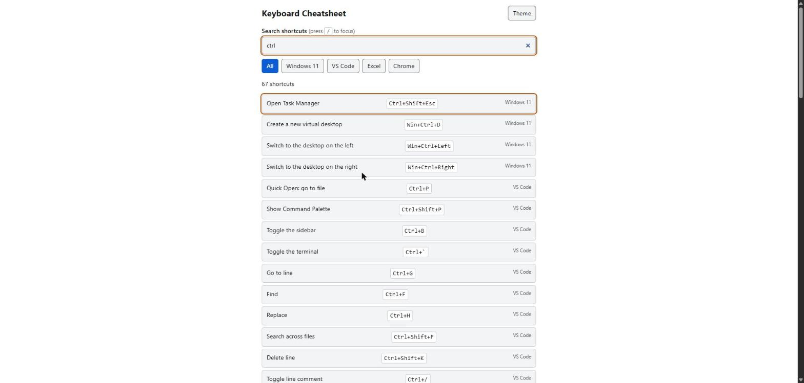
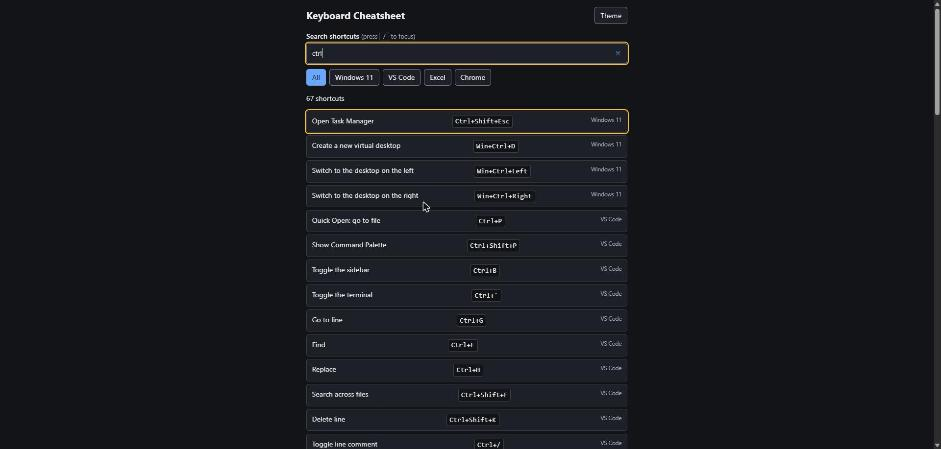
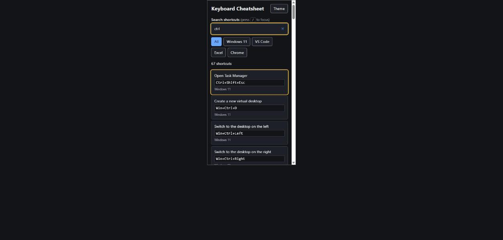
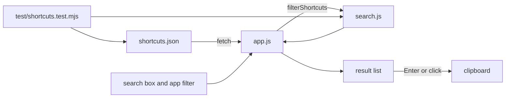

# Keyboard Cheatsheet

A static web page where you search keyboard shortcuts for Windows 11, VS Code, Excel and Chrome.

I work with the keyboard only, and I kept losing time hunting for shortcuts in long vendor pages. So I put the ones I use into one searchable page that never needs the mouse.



Dark theme, and the 375px wide phone layout:





## Quick start

```bash
git clone https://github.com/YazanAlshareef/keyboard-cheatsheet.git
cd keyboard-cheatsheet
npm test
npm start
```

Then open http://localhost:8000. You need Node 20 or newer, and Python 3 to serve the files.

## What it does

- Type to search. Every word must match the app, the keys or the action, so "ctrl shift p" finds the VS Code palette. "windows" and "control" work as well as "Win" and "Ctrl".
- One filter button per app.
- `/` focuses search (not when you hold Ctrl, Alt or Meta, so it leaves Ctrl+/ alone). Up and Down move through results, Enter copies the shortcut.
- Light and dark theme. It follows the system, the button overrides it, and the choice stays in your browser only.
- Visible focus outline, responsive layout, no tracking, no cookies, no outside requests.
- All data is in `shortcuts.json`. No shortcuts for any AI tool are in it.

## How the data moves



## How an AI coding assistant helped

An AI coding assistant wrote the first version of the files and the shortcut list from the official pages below. I read the code, ran the tests and checked the page by hand. `WALKTHROUGH.md` says what each file does.

## What broke and how I fixed it

- `node --test test/` failed on Node 24 with a bare "test failed", and a shell glob does not expand on Windows with Node 18 to 20. Plain `node --test` finds the files in `test/` on every version, so that is what I use.
- My "no AI tool shortcuts" test matched "cursor" inside "multi-cursor", which is a real VS Code feature. The test now looks only for AI product names.
- The browser console showed a 404 for `favicon.ico`. I added an empty inline icon in `index.html`.
- A first draft had shortcuts I could not confirm, so I took them out. On the Excel page `Ctrl+Shift+L`, `Ctrl+F` and `Ctrl+H` show up only in the Mac or web sections, not the Windows tables. `Ctrl+R` in the Windows section means "rename the table" in Power Pivot, not fill right. VS Code "new terminal" is not on the default keybindings page.
- In my own review I found that `/` also fired on Ctrl+/ and swallowed it, and that searching "windows lock" found nothing because the data says "Win". Both are fixed and each has a test.

## Diagrams

- [Components](docs/diagrams/components.md): the files and what depends on what.
- [Flows](docs/diagrams/flows.md): page load, and search and copy.

## Checks I ran

- `npm test`: 7 tests pass locally (JSON shape, no duplicates, no AI names, search, aliases, the `/` rule).
- `.github/workflows/ci.yml` runs the same `npm test` on every push. I have not seen that run yet, so treat the Actions result as the proof.
- Contrast: I computed WCAG ratios from the CSS colours with a small script. Body, muted and accent text are all above 4.5:1 in both themes. Input and button borders were too faint (1.6:1), so I made them darker; they are now above 4:1.
- Looked at the page in Chrome in light and dark. For the phone width I loaded the page in a 375px frame and found no horizontal scroll. I did not test on a real phone.
- Lighthouse: not run, so there is no score.
- Not tested with a screen reader. The ARIA wiring (combobox, listbox, live regions) follows the pattern but I have not heard it read out.

## Limits

- Windows keyboard shortcuts only. Mac and Linux are not covered.
- They are the defaults. If you rebind keys, the page is wrong for you.
- 112 shortcuts, a small selection and not a full list.
- Copy needs a secure context (HTTPS or localhost). The page shows a message if the browser blocks it.
- "Ctrl+Plus" and "Ctrl+Minus" are spelled out so the search box can find them.
- Checked on 2026-11-10: I compared each shortcut by hand-run page fetches against the official pages below. That is not automated and the pages can change.
- Not deployed, so there is no live URL. The Vercel command line tool was not installed and I skipped it.
- There is no build step. `npm run build` just runs the tests.

## Sources

I compared every shortcut with these official pages on 2026-11-10. If the page did not state a shortcut for Windows, I dropped it.

- Windows 11: https://support.microsoft.com/en-us/windows/keyboard-shortcuts-in-windows-dcc61a57-8ff0-cffe-9796-cb9706c75eec
- VS Code: https://code.visualstudio.com/docs/reference/default-keybindings
- Excel: https://support.microsoft.com/en-us/office/keyboard-shortcuts-in-excel-1798d9d5-842a-42b8-9c99-9b7213f0040f
- Chrome: https://support.google.com/chrome/answer/157179

Wording notes. `Win+Down` reads "Restore or minimize the window", but the Windows 11 page only says "Minimize the active window"; I added the restore part from how the key behaves. `Win+A` reads "Open Quick Settings", where the page I read called it the action center. The Excel time shortcut is listed as `Ctrl+Shift+:`.

## Licence

MIT. See `LICENSE`.
