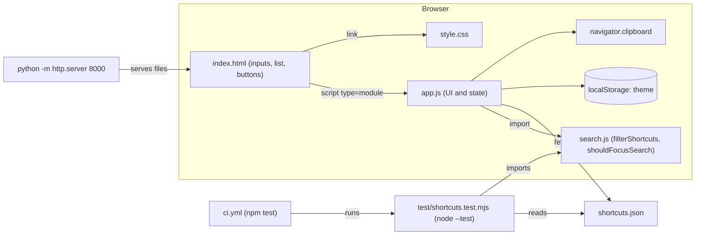

# Components

Shows the files in the page and what each one depends on.

Source: [index.html](../../index.html), [app.js](../../app.js), [search.js](../../search.js), [shortcuts.json](../../shortcuts.json), [style.css](../../style.css), [test/shortcuts.test.mjs](../../test/shortcuts.test.mjs), [package.json](../../package.json), [ci.yml](../../.github/workflows/ci.yml)

