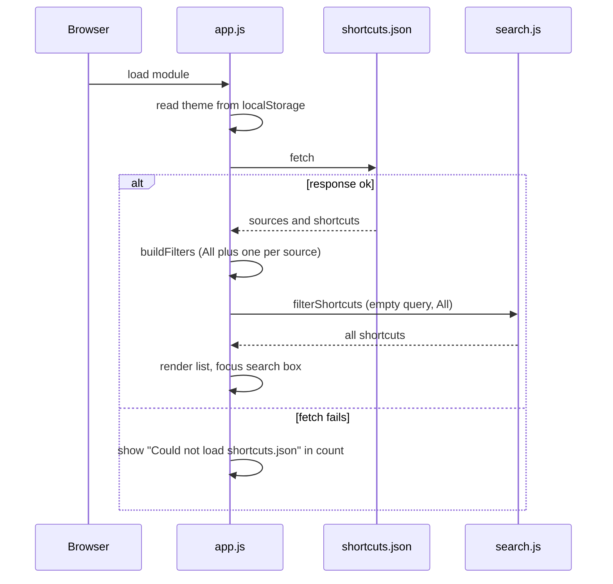
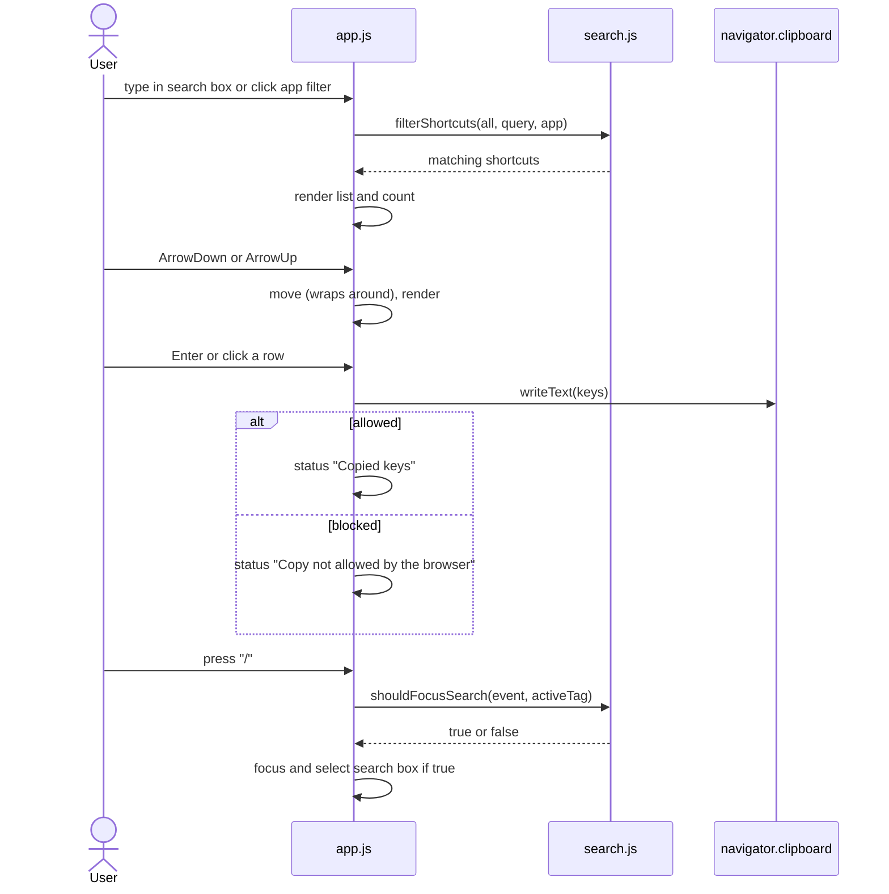

# Flows

Two sequence diagrams: page load, then search and copy.

Source: [app.js](../../app.js), [search.js](../../search.js), [shortcuts.json](../../shortcuts.json)

## Page load

Shows how `app.js` loads the data and builds the filter buttons.

## Search and copy

Shows what happens when the user types, moves through results and presses Enter.

